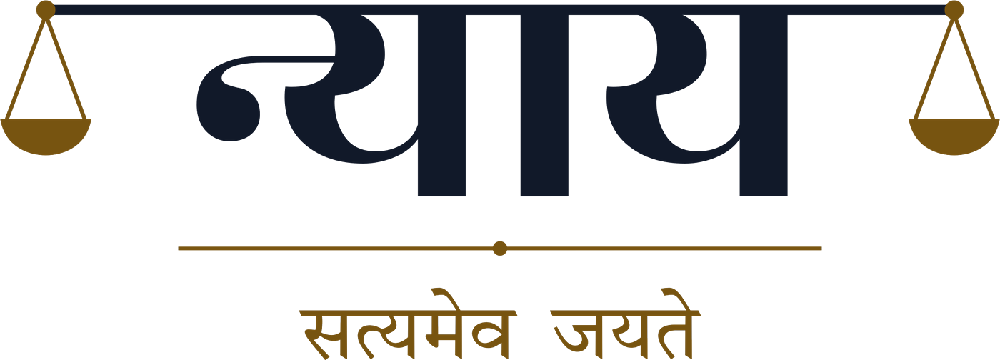

# Nyaay

<p align="center">
  <picture>
    <source media="(prefers-color-scheme: dark)" srcset="web/public/brand/logo-full-dark.png">
    
  </picture>
</p>

<p align="center"><b>The legal workspace for Indian advocates.</b><br>
Research to the paragraph, check every citation, and never miss a statutory deadline. Runs privately on your own computer.</p>

> **Proprietary and confidential.** Copyright © 2026 Balwinder Singh Labana. All rights reserved.
> Nyaay is not open source. No one may use, copy, install, run, modify, distribute, sell, host or show this
> software or its documentation, in whole or in part, without the prior written permission of the owner.
> See [`LICENSE`](LICENSE) and **Ownership and permitted use** at the end of this file.

## What Nyaay does

| Area | What it does |
|---|---|
| **Research** | Searches Supreme Court and High Court judgments down to the paragraph, with filters by court, year, Act and section. Ask a question and the Research Agent answers with the paragraphs it relied on. |
| **Judgment reader** | The full judgment, numbered by paragraph, with a navigator, citations, who cites it, and an AI headnote you can check. |
| **Citation check** | Matches every citation in a draft to a judgment and paragraph. Nothing is marked Verified until the AI or an advocate confirms it. |
| **Matters** | Every case with its stage, next hearing, orders, tasks, drafts, notes and saved authorities, and one timeline of every date. |
| **Statutory deadlines** | Worked out by fixed rules (for example NI Act s.138 and s.142) from the dates you confirm, moved past court holidays. Never by AI. |
| **Approvals** | Everything Nyaay proposes waits for an advocate. Every decision is recorded with the name of the person who made it. |
| **AI Agents** | Research, Judgment Analysis, Citation Verification and Drafting agents run in the background and show every step they take. |
| **Bare Acts and IPC to BNS** | Sections of the Acts you cite, linked to the judgments that discuss them, and conversion between the old and new criminal laws. |
| **Authority map** | How the judgments in your library cite each other and how later courts treated them. |
| **Library and Gold set** | Loads official open data, scores data quality, and keeps headnotes verified by your own advocates. |

Every feature has an **(i)** next to its name in the app that explains what it is and how to use it.

**Principles:** AI proposes, an advocate decides. Deadlines come from fixed rules. Nothing an AI agent writes is applied
until a person acts on it. Client data stays on the machine running Nyaay.

## Run on Windows (first time)
1. Install Python 3.9+, Node.js 20+, and Ollama (ollama.com). Open Ollama.
2. Double-click `setup-ai.bat` (downloads the local AI models, once, about 8 GB).
3. Double-click `start-nyaay.bat`. It sets itself up the first time (a few minutes), then opens http://localhost:3000. Close its window to stop Nyaay.
4. Create your chambers account, then open **Library** and click **Load real judgments** (Supreme Court, CC-BY-4.0).

Everything runs on your computer. No sample data is included. Nothing leaves your machine except the open-data downloads.

## If something does not work
Double-click `check-nyaay.bat` (or run `python -m app.doctor`). It tests Python, Node, Ollama and the models, OCR, disk space,
ports, the database and the open-data download, and prints the exact command that fixes each problem.
The same check is in the app: Settings > Data & pilot > System check.

## Scanned orders (OCR)
Photos and scans of court orders, and scanned judgments you upload, are read with Tesseract OCR. Install it once:
- Windows: https://github.com/UB-Mannheim/tesseract/wiki. In the installer tick **Hindi** and **Marathi** under additional language data.
  Nyaay finds it in its default folder. Then `.venv\Scripts\pip install pytesseract pillow pymupdf` (start-nyaay.bat does this for you).
- Mac: `brew install tesseract tesseract-lang`. Ubuntu: `sudo apt install tesseract-ocr tesseract-ocr-hin tesseract-ocr-mar`.

Anything read from a scan is marked for checking. Every page gets a confidence score, and pages under 70% are named so you check them
against the original. Without Tesseract, Nyaay can use a local vision model (`OLLAMA_VISION_MODEL`, see `.env.example`); its text is
always marked for review.

## Legal review
Settings > Legal review > Legal review pack downloads one Word file with every deadline rule, worked date examples, every stage and every
draft template, with tick boxes and a sign-off page. Give it to an advocate. You can also run `python -m app.review_pack`.

## Data tools
- **Bare Acts** (sidebar): the sections of the Acts you cite, searchable by number or words, linked both ways to the judgments that discuss them.
  An admin presses *Download Acts* once (IPC, CrPC, CPC, Evidence Act, NI Act, Motor Vehicles Act, Constitution, and the IPC→BNS, CrPC→BNSS,
  Evidence Act→BSA tables). BNS, BNSS and BSA come from the official PDFs: *Load official text* refuses the file unless it has exactly 358, 531
  and 170 sections. Downloaded copies are community copies: check against India Code before citing.
- **Section tags**: every judgment is tagged with the Acts and sections it discusses. Research can filter by Act and section.
- **Data quality** (Library): every judgment is scored out of 100 with the reasons; fix details, list scans that need OCR, find duplicates, export CSV.
- **Gold set** (sidebar): an advocate reads a judgment, writes the headnote in their own words and verifies it. Verified entries show on the
  judgment and measure whether search puts the right authority first.
- **Database**: `python -m app.dbtool status | upgrade | move | backup | restore | verify-backup` (see `DEPLOY.md`).

## Putting it on a server
See `DEPLOY.md`.

## Notes
- Playbooks stay DRAFT until an advocate signs off in Settings > Legal review.
- Tests: `python -m pytest -q`
- Security problems: see [`SECURITY.md`](SECURITY.md). Please do not report them in public issues.

## Updating to the latest version
In the `nyaay` folder (VS Code terminal, PowerShell):
```
git pull
.\start-nyaay.bat
```
Nyaay rebuilds its screens by itself when files change, and updates the database automatically on start.

## For the team: saving and uploading changes
```
git add -A
git status          # check no .env, database, logs or backups are listed
git commit -m "Describe what changed"
git push
```

## Where things are
| Folder | What is in it |
|---|---|
| `app/` | The server (Python, FastAPI): routes, services, AI agents, deadline rules, database migrations |
| `web/` | The app people use (Next.js, React): screens in `web/src/app`, shared parts in `web/src/components`, logo and intro in `web/public/brand` |
| `tests/` | Automated tests: `python -m pytest -q` |
| `docs/` | Pilot and privacy notes, and `docs/redesign/` (design system, motion, architecture, test results, limitations) |
| `deploy/` | Files for running Nyaay on a server (see `DEPLOY.md`) |

## Ownership and permitted use

**Owner.** Nyaay, including its source code, design, user interface, the न्याय logo and intro film, playbooks, draft
templates, review pack, documentation and the name "Nyaay", is the property of Balwinder Singh Labana.
Copyright © 2026 Balwinder Singh Labana. All rights reserved.

**No licence is granted** by receiving, downloading or viewing this software. Any use requires a written
permission from the owner that names the person or firm, the purpose, the number of users and the period.
Without it, you may not:

- install, run or use Nyaay, or let anyone else use it;
- copy, modify, translate, reverse-engineer, or create works based on it;
- share, sell, rent, sub-license, publish or host it, or show it to third parties;
- use it to train or evaluate any AI model, or use the name "Nyaay" or the न्याय logo;
- remove or change this notice or any copyright or ownership marks.

**Pilots and evaluations.** Anyone given access for a pilot, demo or evaluation receives it in confidence, only
for the agreed purpose and period, and must return or delete every copy when asked or when the period ends.
Feedback and suggestions may be used by the owner freely.

**Patents.** The owner may seek patent protection for inventions embodied in Nyaay. Access to this software
does not grant any right under any patent or patent application.

**Third-party components.** Open-source libraries and open data used by Nyaay (for example the Supreme Court
and High Court judgment datasets, CC-BY-4.0) remain under their own licences. This notice covers only the
owner's work.

**No warranty, not legal advice.** Nyaay is a tool for advocates. It does not give legal advice, and every
output must be checked by a qualified advocate before it is relied on. It is provided "as is", without warranty.

For permission or licensing enquiries, contact the owner, Balwinder Singh Labana: labanabalwindersingh16@gmail.com
